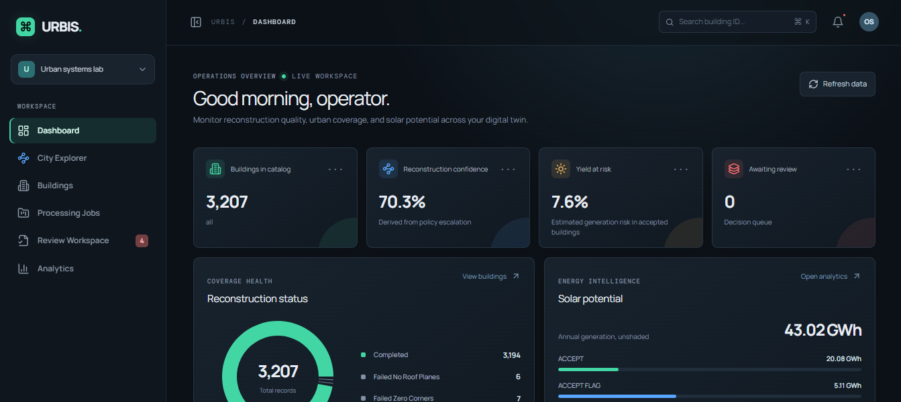
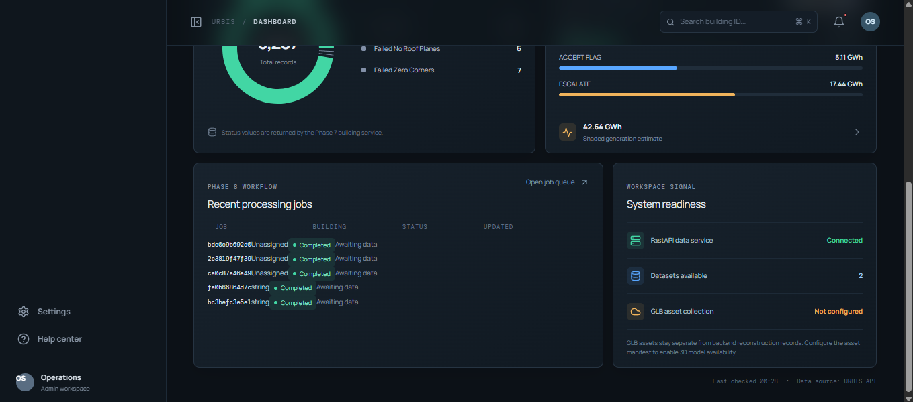
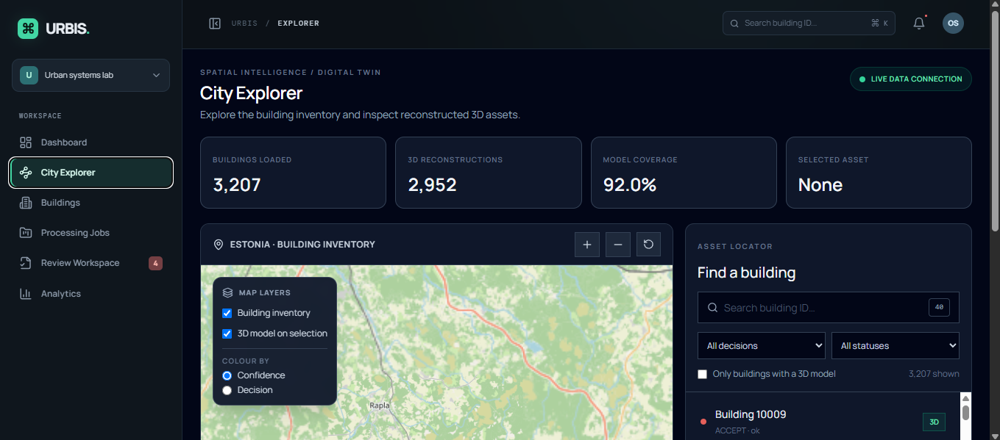
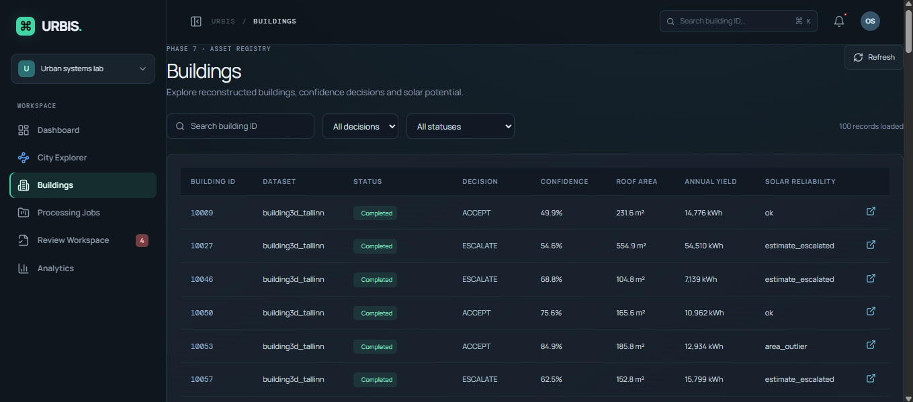
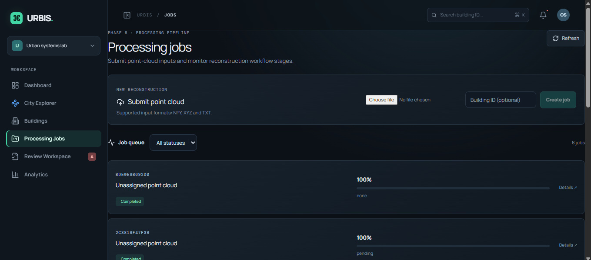
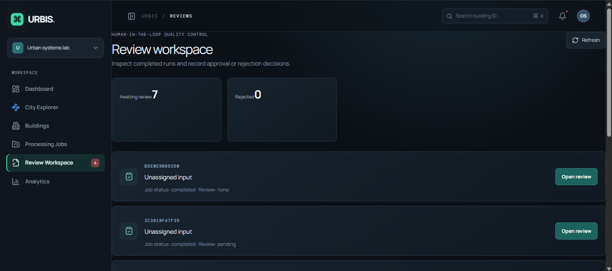
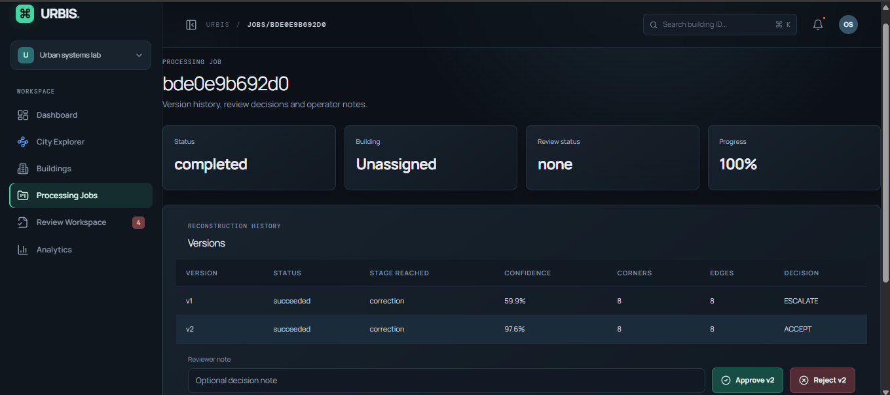
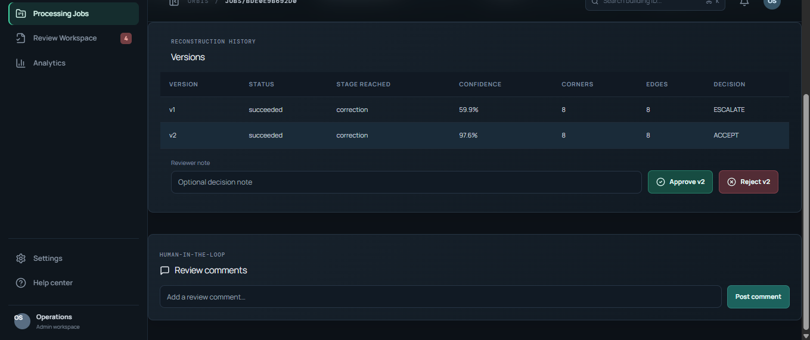
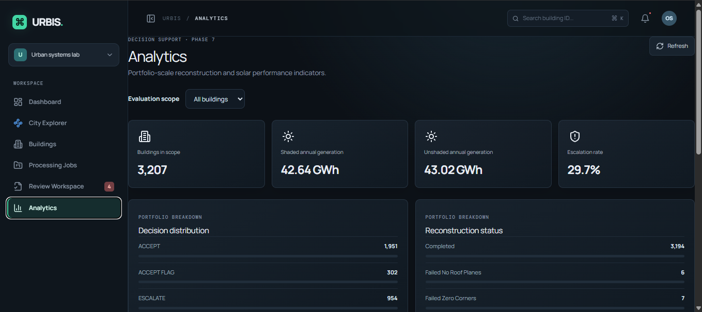
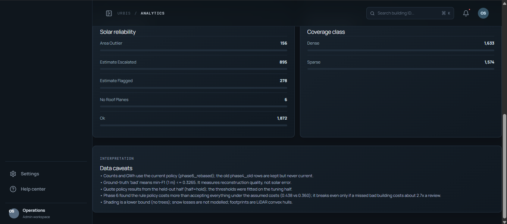

# URBIS – Urban Intelligence and Self-Correction

URBIS takes LiDAR scans of buildings in Tallinn and turns them into 3D building models. It also tells you how much to trust each model, and sends the doubtful ones to a person to check. On top of that, it estimates how much solar energy each roof could produce.

This is our final-year major project. It uses the [Building3D](https://building3d.ucalgary.ca/) Tallinn dataset (3,207 test buildings).

## What it does

1. **Rebuilds** each building's roof from its LiDAR point cloud.
2. **Scores** how confident the model is, and checks the result against OpenStreetMap and Microsoft building footprints.
3. **Decides** for each building: accept it, accept it with a flag, or send it for human review.
4. **Estimates solar power** from the roof planes (angle, direction, and shade from nearby buildings).
5. **Shows it all** in a web app with a 3D city map and a review workflow.

## Screenshots


*Dashboard: Overview of building reconstructions, confidence scores, solar potential, and pending reviews.*


*Dashboard Overview: Monitor recent reconstruction jobs, building statistics, and backend status.*


*City Explorer: Explore reconstructed buildings on an interactive map and locate individual assets.*


*3D Building Viewer: Inspect individual 3D buildings alongside their reconstruction confidence and solar estimates.*


*Building Registry: Browse buildings and compare their reconstruction status, confidence, and solar estimates.*


*Processing Jobs: Submit LiDAR point clouds and track reconstruction job progress.*


*Review Workspace: Find completed reconstructions awaiting human review and approval.*


*Reconstruction History: Compare reconstruction versions and inspect confidence scores and correction results.*


*Review & Approval: Approve or reject reconstructed buildings, add notes, and leave review comments.*


*Analytics: View city-wide reconstruction statistics, decision distributions, and estimated solar generation.*


*Model Analytics: Explore reconstruction reliability, building coverage, and data quality insights.*

## How it was built

| Phase | What we did |
|---|---|
| 1 | Downloaded and cleaned the Building3D Tallinn data and split it into train / validation / test. |
| 2 | Trained two neural networks: one finds roof corners, the other decides which corners are joined by an edge. |
| 3 | Measured uncertainty by running the model several times with small changes, then compared results with OpenStreetMap and Microsoft footprints. |
| 4 | Built a simple rule that accepts, flags or escalates each building. |
| 5 | Fitted roof planes to the raw points and estimated yearly solar energy using PVGIS data. |
| 6 | Evaluated everything on buildings the model had never seen. |
| 7 | Built the backend (FastAPI + PostgreSQL/PostGIS) with a map-search API. |
| 8 | Added jobs and reviews: upload a scan, watch progress live, approve or reject the result. |
| 9 | Built the React + Cesium web app with the 3D city explorer. |

## Results

Tested on 1,604 buildings the model never saw:

| What we measured | Result |
|---|---|
| Roof corners found correctly (F1) | 0.749 |
| Roof edges found correctly (F1) | 0.420 |
| Does low confidence predict a bad result? (AUC) | 0.769 |
| Bad buildings among the accepted ones | 18.0% before triage, 10.2% after |
| Solar estimate coverage | 3,201 of 3,207 buildings, about 42.6 GWh per year in total |

## Known limitations

- The model is much better at corners than at edges.
- The review step catches many bad buildings, but under the costs we assumed it is still more expensive than accepting everything. Those costs were assumed, not measured.
- On a different dataset (City3D) the model's confidence drops a lot, so treat that as a stress test, not an accuracy score.
- Solar numbers are estimates. They were not compared with real measured output, and shading from trees is not included.
- The 3D models in the viewer are tidied-up display models. Walls come from the building outline and the roof comes from the fitted roof planes. They are not the raw neural network output.
- The job pipeline in the web app is a placeholder. New uploads show the full workflow, but their confidence numbers are not produced by the real models.

## Project structure

```
backend/              FastAPI app, database, seed loader, tests, Docker setup
frontend/             React + TypeScript + Vite web app (Cesium for the 3D map)
tools/                Script that builds the 3D models shown in the viewer
screenshots_urbis/    Screenshots used in this README
```

## How to run it

You need Docker Desktop and Node.js 18 or newer.

**1. Start the backend and database**

```bash
cd backend
docker compose up -d --build
```

Then open <http://localhost:8000/health> to check it is running, or <http://localhost:8000/docs> to try the API.

The large data files are not stored in git. Put the seed data where the `etl` service expects it, and the 3D models in `backend/models/glb/` with `glb_manifest.json` in `backend/models/`.

**2. Start the web app**

```bash
cd frontend
npm install
npm run dev
```

Open <http://localhost:5173>. The app expects the backend at `http://localhost:8000`, and it needs internet for the map tiles.

**3. Run the tests**

```bash
cd backend
pytest
```

## Rebuilding the 3D models (optional)

`tools/build_lod_glb.py` creates the 3D models shown in the viewer. It builds the walls from each building's outline and the roof from its fitted roof planes.

```bash
python tools/build_lod_glb.py \
  --npz-dir <folder with the .npz files> \
  --manifest backend/models/glb_manifest.json \
  --planes <phase5_roof_planes.csv> \
  --ground-from-manifest \
  --ids 10057 10180 4409 \
  --out lod_glb --install backend/models
```

Each `.npz` file holds one building's points, scale and center. After running it, restart the backend so it picks up the new models.

## Tech used

Python, PyTorch, FastAPI, PostgreSQL + PostGIS, Docker, React, TypeScript, Vite, CesiumJS.

## Credits

Point clouds and reference models: [Building3D](https://building3d.ucalgary.ca/). Building footprints: OpenStreetMap contributors and Microsoft Global ML Building Footprints. Solar irradiation data: PVGIS (European Commission JRC).
